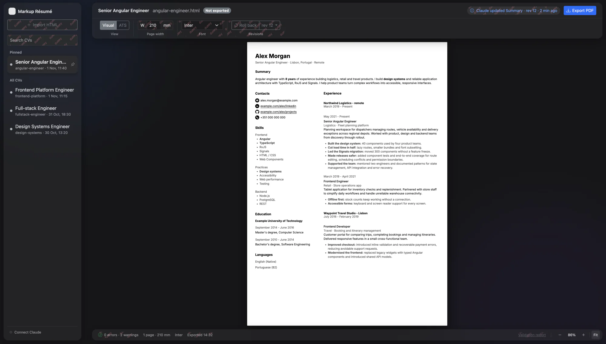
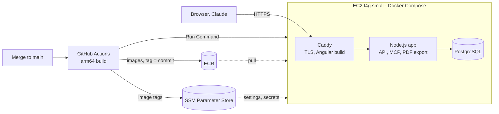

# Markup Résumé

[](https://markup-resume.xyz)
[](https://github.com/dshelemonchak/markup-resume/releases)
[](https://github.com/dshelemonchak/markup-resume/actions/workflows/check.yml)
[](https://github.com/dshelemonchak/markup-resume/actions/workflows/deploy.yml)
[](LICENSE)

A workspace for tailoring CVs to different roles with the AI assistant you already use. Switch between CVs
from the sidebar, edit through chat, see changes live and export a PDF that is checked before download.

Content editing happens through MCP. The application keeps your CVs together and gives you a place to review
the result, pin the versions you use most and export the finished document.

**Live at [markup-resume.xyz](https://markup-resume.xyz).** Sign-in is limited to an allow-list of GitHub accounts
for now; open registration comes after a page for managing connected clients
([#34](https://github.com/dshelemonchak/markup-resume/issues/34)).

**Status:** early development, running in production. The service is hosted on AWS, provisioned with Terraform
and deployed by GitHub Actions on every merge to `main` that changes the app. claude.ai connects to the hosted MCP
endpoint over OAuth 2.1; locally, Claude Code and Codex use the same tools. One bundled template, sign-in with
GitHub. Integration with ChatGPT Desktop is planned.

[Stack](#tech-stack) · [Purpose](#why-this-project) · [Features](#features) · [Screenshots](#screenshots) ·
[Production](#production) · [Setup](#getting-started) · [MCP](#mcp-integration) ·
[Architecture](#project-structure-and-architecture) · [Development](#development) · [Roadmap](#roadmap)

## Tech stack


- **Frontend:** Angular standalone components, signals, zoneless change detection, RxJS, SCSS, Bootstrap and
  Transloco. Live document updates through Server-Sent Events and a sandboxed preview.
- **Backend:** Node.js, TypeScript, Hono, Kysely and PostgreSQL. Ports and adapters, SQL migrations, transactional
  revision storage, document validation, an MCP server with Zod tool schemas and its own OAuth 2.1 authorisation
  server for remote clients. PDF export through headless Chromium, checked with Poppler.
- **Infrastructure:** AWS (EC2 Graviton, ECR, SSM Parameter Store and Session Manager, S3), all of it in
  Terraform. Docker Compose on the server, with Caddy serving the Angular build and terminating TLS with Let's
  Encrypt certificates.
- **Delivery and quality:** pnpm monorepo, multi-stage Docker images, GitHub Actions for CI and continuous
  deployment with SemVer releases from conventional commits; Vitest, Angular component tests, real PostgreSQL and
  Chromium integration tests, ESLint-enforced architecture boundaries and Prettier.

## Why this project

A short CV leaves room for only part of your experience. An Angular vacancy, a Node.js role and a full-stack
position may call for different projects, achievements and emphasis. The goal is to highlight the most relevant
parts of the same experience while keeping the underlying facts consistent. Each CV variant develops its own
history as you refine it.

I built Markup Résumé for that everyday workflow. Working with separate Word files meant keeping track of copies
and repairing formatting. Designing a CV in Figma gave me more visual control, but added AI usage limits and PDF
exports whose text did not always copy back as intact words.

I wanted to keep the conversation with my existing assistant, move quickly between CVs and review the result in
a focused interface. That is the product's scope: content editing through MCP, a live viewer with a persistent
CV sidebar, and automatic PDF checks. A manual content editor is outside the current plan.

The project is also a way to deepen my backend and full-stack engineering skills by building and operating a
tool I use myself, with the intention of making it useful to others with a similar workflow.

## Features

- **Switch CVs without leaving the workspace.** The sidebar stays next to the preview. Select another CV in one
  click and pin frequently used variants to keep them together.
- **Edit with your own assistant.** Create a CV, rewrite a section or prepare a variant for a vacancy through
  MCP, using the context available in your AI client. Markup Résumé does not call a model API or require a model
  API key. Your assistant's own usage limits still apply.
- **Review changes live.** The viewer refreshes after the assistant saves a document, so you can keep the chat
  and preview open while refining the CV.
- **Keep document history.** PostgreSQL stores numbered revisions and their authors. MCP can read the current
  document or a specific revision; the revision browser and rollback controls in the UI are still planned.
- **Validate every write.** The application checks the document against the template schema before saving it.
  Unsupported markup, inline styles, scripts and external resources are rejected; template CSS is inserted by
  the application.
- **Check every PDF before download.** Each export compares the PDF with the rendered document to detect missing
  or extra words, split or reordered text blocks, font problems and missing clickable links. If checks fail,
  the regular download is stopped and the UI shows a report. Downloading despite the reported problems requires
  a separate **Download anyway** action.

**PDF export happens in the application UI:** select a CV and click **Export PDF**. MCP tools edit HTML and do not
return PDF files or download links. The checks verify specific properties of the exported file; they do not
guarantee acceptance by every applicant tracking system (ATS).

## Screenshots



_The workspace with one pinned CV and three alternative versions. Controls marked “dummy” are still under
development._

## Production

The hosted service at [markup-resume.xyz](https://markup-resume.xyz) runs on one AWS instance. Everything around it
is code in this repository: the infrastructure in [infra/terraform](infra/terraform/README.md), the runtime in
[compose.prod.yaml](compose.prod.yaml) and [deploy/Caddyfile](deploy/Caddyfile), the pipeline in
[deploy.yml](.github/workflows/deploy.yml).



- **Continuous deployment.** A merge to `main` that changes the app builds arm64 images, pushes them to ECR tagged
  with the commit, restarts the stack over SSM Run Command, checks `/api/health` and publishes the next SemVer
  version as a [GitHub Release](https://github.com/dshelemonchak/markup-resume/releases).
- **No SSH.** The security group opens only ports 80 and 443; shell access goes through SSM Session Manager.
- **Secrets stay out of git, images and Terraform state.** They live in SSM Parameter Store and are assembled into
  the Compose environment when the stack starts. Terraform creates the parameters with write-only placeholders.
- **Data survives the server.** PostgreSQL and Caddy's certificates live on a separate encrypted EBS volume, so
  the instance can be replaced from Terraform without losing them.
- **Access.** Sign-in is limited to an allow-list of GitHub accounts; MCP clients are authorised by the app's own
  OAuth 2.1 server.

Backups and monitoring are the next steps on the [roadmap](#roadmap).

## Getting started

### Requirements

- Git.
- Docker with Compose v2, such as Docker Desktop on macOS.
- For AI editing, an MCP client that can reach the local Streamable HTTP endpoint. The repository includes a
  Claude Code configuration.

Node.js, pnpm, PostgreSQL, Chromium and Poppler run in containers; no host installation is needed. The development
image supports both amd64 and arm64. A GitHub OAuth App is needed to sign in (see below).

### Set up GitHub sign-in

The UI signs you in with GitHub; the app only learns who you are (scope `read:user`) and keeps no GitHub token.

1. Create an OAuth App at [github.com/settings/applications/new](https://github.com/settings/applications/new):
   homepage `http://localhost:4200`, callback URL `http://localhost:4200/auth/github/callback`.
2. Generate a client secret on the app's page.
3. Copy [.env.example](.env.example) to `.env` and fill in `GITHUB_CLIENT_ID`, `GITHUB_CLIENT_SECRET` and
   `OWNER_GITHUB_ID`, your GitHub user id (the `id` in `https://api.github.com/users/<your-login>`). Git ignores
   `.env`; Compose reads it.

Use a separate OAuth App for any other deployment: each app has one callback URL, and its secret belongs only to
that environment.

### Start the application

Run these commands from a terminal:

```bash
git clone https://github.com/dshelemonchak/markup-resume.git
cd markup-resume

# Build the toolbox and wait for PostgreSQL to be ready.
docker compose up --build --wait dev db

# Install the versions recorded in the lockfile.
docker compose exec dev pnpm install --frozen-lockfile

# Start the API, MCP endpoint and Angular development server.
docker compose up -d app web
```

Open [localhost:4200](http://localhost:4200) after the Angular server finishes starting and sign in with GitHub.
Then add a fictional example CV for the account in `OWNER_GITHUB_ID`:

```bash
docker compose exec dev pnpm seed
```

The sample CV is available without connecting an assistant. Select it and click **Export PDF** to try the export
workflow.

| Service    | Local address                  | Purpose                            |
| ---------- | ------------------------------ | ---------------------------------- |
| Web UI     | `http://localhost:4200`        | CV preview, pinning and PDF export |
| HTTP API   | `http://localhost:3000/api/v1` | Data and events for the UI         |
| MCP        | `http://localhost:3000/mcp`    | Tools for the assistant            |
| PostgreSQL | `localhost:5433`               | Database access from host tools    |

The app and seed command apply pending database migrations automatically. Every CV belongs to the user who signed
in, and the UI shows only that user's CVs. CVs and revisions live in the named Docker volume `markup-resume-db` and survive container
restarts. The development database name, username and password are all `markup`.

To stop the stack while keeping the database, run `docker compose down`. Adding `-v` deletes the database volume
and all stored CVs and revisions.

This Compose setup is for local development. The UI and API need a sign-in; MCP serves only this machine (its port
is published on `127.0.0.1`) and acts for `OWNER_GITHUB_ID`. The web port is published on all host interfaces by
default. Do not expose this stack to the internet; the hosted setup is described under
[Production](#production).

### Configuration

The defaults are supplied by [compose.yaml](compose.yaml) and the [Dockerfile](Dockerfile).

| Variable                                   | Purpose                                                                                                    | Container default                         |
| ------------------------------------------ | ---------------------------------------------------------------------------------------------------------- | ----------------------------------------- |
| `DATABASE_URL`                             | PostgreSQL connection used by the app, seed, importer and database tests                                   | `postgres://markup:markup@db:5432/markup` |
| `PORT`                                     | HTTP API and MCP listening port                                                                            | `3000`                                    |
| `CHROME_PATH`                              | Browser executable for PDF export; export is unavailable when unset                                        | `/usr/bin/chromium`                       |
| `LEGACY_RESUME_DIR`                        | Root directory for importing CVs from older file-based versions                                            | `/data` in the `dev` service              |
| `GITHUB_CLIENT_ID`, `GITHUB_CLIENT_SECRET` | The GitHub OAuth App for sign-in; the app does not start without them                                      | from `.env`                               |
| `APP_ORIGIN`                               | Where the browser opens the app: the GitHub callback and the CSRF check use it                             | `http://localhost:4200`                   |
| `OWNER_GITHUB_ID`                          | GitHub user id that seed, the importers and local MCP act for; that user must have signed in once          | from `.env`                               |
| `MCP_URL`                                  | Public URL of the MCP endpoint. `https`: MCP needs OAuth. `http` on localhost: a local run without OAuth   | `http://localhost:3000/mcp`               |
| `ALLOWED_GITHUB_IDS`                       | Comma-separated GitHub user ids that may sign in; unset lets anyone in, which an `https` `MCP_URL` refuses | unset                                     |

### Import CVs from an earlier version

If an older checkout stored documents at `data/cvs/<slug>/document.html`, run this after starting the database:

```bash
docker compose exec dev pnpm import:files
```

The importer upgrades legacy document vocabulary, validates each document and stores it as the first revision.
Existing slugs are skipped. Rejected documents are reported for correction; old `history/` files are not imported.

### Move CVs from before sign-in

A database from before sign-in keeps its CVs for a local owner. After signing in once, move them to the account in
`OWNER_GITHUB_ID`:

```bash
docker compose exec dev pnpm claim:local-resumes
```

Nothing moves if that account already has a CV with one of the same slugs; the command lists them.

## MCP integration

MCP gives an assistant explicit tools to work with the application's documents. The server runs inside the same
process as the HTTP API and is available at `http://localhost:3000/mcp` while the `app` service is running.

**Claude Code and Codex both work with the local MCP server.** Both can list CVs, read current and previous
revisions, inspect template rules, create variants and save edits. Changes appear live in the application;
PDF export remains in the application UI.

The checked-in [.mcp.json](.mcp.json) points Claude Code at this endpoint. Open the repository in Claude Code and
check the `markup-resume` connection with `/mcp`. Codex uses the same Streamable HTTP endpoint through its own
MCP configuration. Other clients need support for Streamable HTTP; their compatibility should be verified
separately.

**Locally, MCP needs no sign-in.** It answers only clients on this machine and works on the CVs of
`OWNER_GITHUB_ID`, so sign in once in the UI with that account. The Claude apps open sign-in pages only over HTTPS,
which a local server does not have.

**Hosted on HTTPS, MCP is authorised with OAuth 2.1,** served by the app itself. On the first connection the client
registers, opens the browser at Markup Résumé, where you sign in with GitHub and allow it; it then works on your CVs
with a short-lived access token that it refreshes. This is how claude.ai connects to
`https://markup-resume.xyz/mcp`. `MCP_URL` decides which: `https` for OAuth, `http` on localhost for a local run.

### Available tools

| Tool            | Purpose                                                                           |
| --------------- | --------------------------------------------------------------------------------- |
| `list_resumes`  | List CVs with their slugs, titles, revision addresses, update times and pin state |
| `read_resume`   | Read the full HTML of the current CV or a numbered revision                       |
| `read_template` | Read a template's structure, allowed classes, writing rules and example document  |
| `create_resume` | Create a validated HTML CV under a new slug                                       |
| `write_resume`  | Save a complete replacement HTML document as a new revision                       |

A slug such as `frontend-engineer` addresses the current document; `frontend-engineer@3` addresses revision 3.
Writes replace the full document rather than patching individual fields. Writing from an older revision creates
a new revision based on it and reports that newer changes were left out; the stored history remains intact.

### Typical workflow

1. Ask the assistant to list your CVs and read the one you want to change.
2. The assistant reads the template rules, edits the document and saves it through MCP.
3. Review the updated CV in the web UI and ask for further edits if needed.
4. Select the CV in the application and click **Export PDF**.

Example prompt:

> Read my existing CV and its template rules. Create a separate version tailored to the vacancy below, keeping
> the original unchanged. Use only experience already present in the CV and ask me about missing details.

The sample CV contains fictional data; replace it with your own information before using a CV for an application.

## Project structure and architecture

```text
packages/
  app/
    src/
      domain/       Pure rules, document types and ports
      app/          Use cases: CV operations, notifications and PDF export
      adapters/     PostgreSQL, HTTP, MCP, HTML parsing, Chromium and Poppler
      main.ts       Composition root for HTTP and MCP
      seed.ts       Fictional sample data
      import-files.ts
  web/              Angular viewer and application controls
  styles/           Versioned templates, fonts and SVG icons
infra/terraform/    AWS: state bucket, ECR and deploy user, the server
deploy/             Caddyfile of the production web image
compose.prod.yaml   Production stack: Caddy, app, PostgreSQL
.github/workflows/  CI checks, database tests, Terraform validation and deploy
.github/scripts/    Release version from conventional commits
.run/               Shared JetBrains run configurations
```

The backend follows ports and adapters. Domain code has no I/O or third-party runtime imports; use cases depend
on domain ports. Adapters provide storage, transport and document processing, and composition roots wire them
together. ESLint enforces the import boundaries, including the rule that adapters do not import one another.

An MCP write goes through the shared validation pipeline before PostgreSQL stores the document and advances its
current revision in a transaction. A change notification reaches the Angular UI over SSE, and the viewer reloads
the document in a sandboxed iframe. PDF export renders the stored document in Chromium and compares the result
with facts extracted by Poppler.

Each template includes `template.css`, `schema.json`, `rules.md` and `example.html`: visual styles, a validation
schema, instructions for the assistant and a working example. The bundled template is `classic`; tests keep its
schema, rules and example consistent.

## Development

Run tooling in the existing `dev` container from the repository root:

```bash
# Lint, formatting, TypeScript, translation keys and unit/integration tests.
docker compose exec dev pnpm check

# Repository tests against real PostgreSQL; requires the db service.
docker compose exec dev pnpm test:db

# Format the workspace.
docker compose exec dev pnpm format

# Regenerate database types after a schema change.
docker compose exec dev pnpm --filter @markup-resume/app db:types
```

The main test suite includes a real Chromium render. Database tests create and remove a separate test database.
GitHub Actions runs the main checks, PostgreSQL tests and Terraform validation for pull requests and pushes to
`main`; merges that change the app are deployed (see [Production](#production)).

Shared JetBrains configurations in `.run/` start **app + web + dev** or just **db**. The app runs with Node's watch mode;
Angular uses its development server. See [AGENTS.md](AGENTS.md) for repository conventions and layer rules.

### Troubleshooting

| Symptom                                                | What to check                                                                                                                                      |
| ------------------------------------------------------ | -------------------------------------------------------------------------------------------------------------------------------------------------- |
| Seed or app cannot connect to PostgreSQL               | Run `docker compose ps`; the `db` service must be healthy before seeding. Use `docker compose logs db app` for details.                            |
| MCP answers 503 "mcp-unavailable"                      | Locally, MCP acts for `OWNER_GITHUB_ID`: set it in `.env`, run `docker compose up -d app`, and sign in once in the UI with that account.           |
| The UI is unavailable or reports an unreachable server | Inspect `docker compose logs app web`; the API and Angular server must both finish starting.                                                       |
| The MCP client cannot connect                          | Check that `app` is running and the client uses `http://localhost:3000/mcp` with Streamable HTTP. This is a protocol endpoint, not a browser page. |
| PDF export is unavailable                              | Use the supplied image, which installs Chromium and Poppler and sets `CHROME_PATH`.                                                                |
| JetBrains cannot reach Docker Desktop on macOS         | Configure its Docker connection to use `unix://<your home>/.docker/run/docker.sock`, or enable Docker Desktop's default socket.                    |

## Roadmap

The MCP editing, live preview, revision storage, pinning and checked PDF export workflow is implemented and runs
in production.
The following work is planned; content editing remains through MCP.

### CV workflow

- [ ] **Colour-coded tags for each CV:** label variants with React, Angular, Node.js, Java or other tags to see
      their technical focus at a glance in the CV list.
- [ ] **Keep vacancy context with each CV:** store the company, role, job posting link, description and notes
      alongside the variant prepared for that application.
- [ ] **Manage CVs:** search, renaming, and a trash with restore.
- [ ] **Browse and restore revisions:** inspect earlier versions and restore one as a new revision. Notify the
      assistant about user-initiated rollbacks on its next interaction with that CV.

### Layout and PDF quality

- [ ] **Export visual and ATS versions:** keep a designed layout alongside a dedicated single-column A4 output.
- [ ] **Configure each CV:** page width, base font size, font family, page limits and required contacts. Support
      layouts that reflow with width and a continuous page sized to its content.
- [ ] **Extend layout checks:** detect clipping, overlap, overflow, incorrect page dimensions, and blank trailing
      pages. Show where a problem occurs and what to fix.
- [ ] **Configure check severity:** choose error, warning or off for individual checks per CV, with defaults
      appropriate to visual and ATS output.
- [ ] **Expand the style library:** more templates and open-licence fonts, template discovery through MCP, and
      versioned upgrades that preserve the previous styles when an update fails validation. Custom style
      overrides are a later extension.

### Accounts and desktop access

- [x] **Sign in with GitHub:** individual accounts, browser sessions and access scoped to each user's CVs; no
      application passwords.
- [x] **OAuth 2.1 for remote MCP:** the app is its own authorisation server; claude.ai connects to the hosted
      endpoint.
- [ ] **Sign in with Google.**
- [ ] **Open registration:** a page of connected clients with token revocation
      ([#34](https://github.com/dshelemonchak/markup-resume/issues/34)), then sign-in beyond the allow-list.
- [ ] **Connect desktop assistants:** verify login and the complete editing workflow in Claude Desktop and ChatGPT
      Desktop, alongside Claude Code and Codex.

### Hosting

- [x] **Hosted service:** AWS EC2 (Graviton), HTTPS through Caddy and Let's Encrypt, infrastructure in Terraform,
      continuous deployment with versioned releases.
- [ ] **Backups:** a nightly `pg_dump` to S3 and a tested restore.
- [ ] **Monitoring:** container logs in CloudWatch, alarms by email.
- [ ] **Separate origin for CV documents** from the signed-in application.

Fact-change detection is still being explored: the definition of a new fact and the treatment of changes to
dates, titles, companies or metrics have not been settled.

Some unfinished UI controls carry a red **dummy** overlay. Their presence does not mean the corresponding feature
is available. The roadmap describes intended work, without release-date commitments.

## License

[MIT](LICENSE).

Bundled assets have their own license notices:

- [Inter](packages/styles/fonts/inter/OFL-LICENSE.txt) — SIL Open Font License 1.1.
- [Contact icons based on Bootstrap Icons](packages/styles/icons/BOOTSTRAP-ICONS-LICENSE.txt) — MIT.
